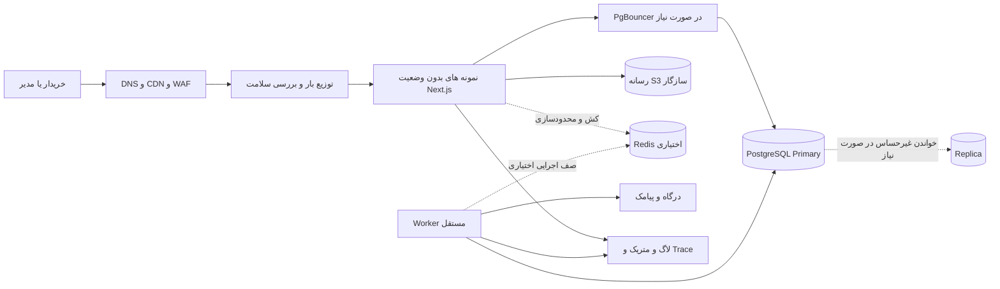

# معماری سیستم

## وضعیت مشاهده‌شده
Next.js App Router، APIهای هم‌مخزن و PostgreSQL 16 با pg. نشست JWT و rate limit مبتنی بر DB، سبد محلی مرورگر و فایل رسانه روی دیسک. سفارش با تراکنش PostgreSQL ثبت می‌شود. تمایز نسخهٔ توسعه و استقرار مقصد در [readiness](PRODUCTION_READINESS.md) آمده است.

## معماری هدف

HTML عمومی و رسانهٔ نسخه‌دار می‌توانند در لبه cache شوند. پنل، نشست، سبد و پیگیری خصوصی از کش مشترک خارج‌اند. outbox در تراکنش اولیه در PostgreSQL نوشته می‌شود. worker رویداد را مصرف و با شناسهٔ یکتا ارسال می‌کند. Redis در صورت نیاز واسطه است و منبع حقیقت نیست. کش با TTL و نسخهٔ رویداد منقضی می‌شود و قطع آن مستلزم fallback محدود است.

| ماژول | مالکیت و رابط | وابستگی و مرز |
|---|---|---|
| Authentication | ورود، MFA، نشست و ابطال | داده نشست، خروج اتمی با ابطال |
| Authorization | نقش، مجوز و subject | Auth؛ ارزیابی سمت سرور در هر عملیات |
| Customers | پروفایل و اطلاعات تماس | Auth در حالت حساب‌دار؛ مالک PII، قرارداد رضایت |
| Products | مشخصات و انتشار | Categories و Media؛ تغییر و audit در یک تراکنش |
| Categories | طبقه‌بندی و ترتیب | قید مرجع با Products |
| Catalog | projection عمومی | Products و Inventory؛ خواندن eventual فقط برای نمایش |
| Inventory | موجودی و رزرو | PostgreSQL؛ شرکت در تراکنش Orders |
| Orders | سفارش، اقلام و تاریخچه | Inventory، snapshot قیمت، idempotency و outbox در commit واحد |
| Payments | تلاش پرداخت و تطبیق | Orders؛ callback دارای idempotency، ثبت نتیجه در commit مستقل |
| Search | نمایه و بازیابی | رویداد Catalog؛ بازسازی‌پذیر از DB |
| Media | شناسه، metadata و فایل | Object Storage؛ finalize و پاک‌سازی یتیم با job |
| Notifications | قالب، ارسال و تلاش دوباره | outbox و درگاه؛ بدون تغییر سفارش |
| Administration | صفحه و orchestration | فقط رابط ماژول‌ها؛ مجوز هر فرمان |
| Audit | ثبت وقایع حساس | سرویس نویسنده در همان transaction؛ حقوق خواندن محدود |

مرزها ابتدا در یک برنامه و یک DB با import کنترل‌شده ایجاد می‌شوند. سود تجاری کاهش ریسک تحویل و سود فنی حفظ تراکنش است. هزینه متوسط، خطر بازنویسی و تداخل schema. وابستگی به تست قرارداد و smoke. معیار، حفظ API و امکان پیگیری مالک هر جدول و فرمان.
